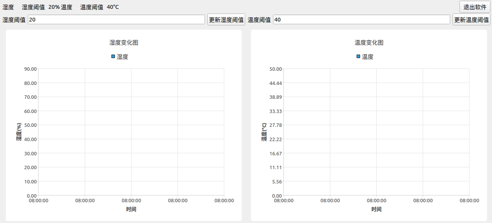
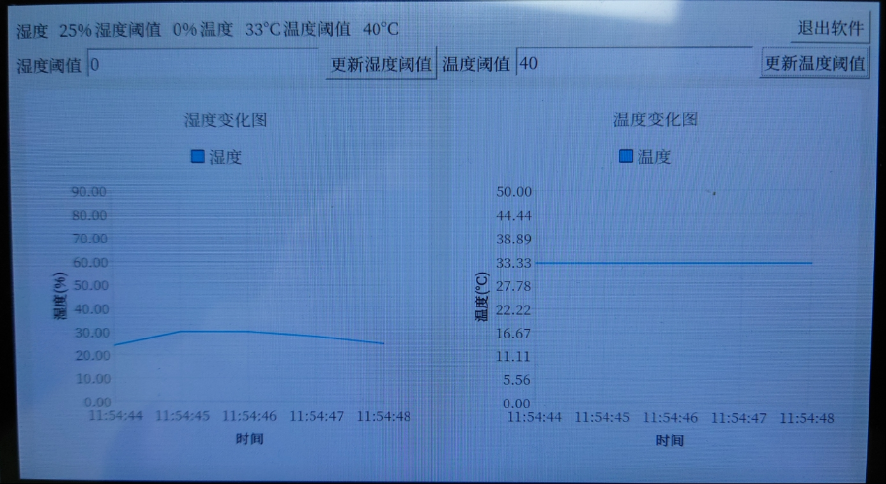
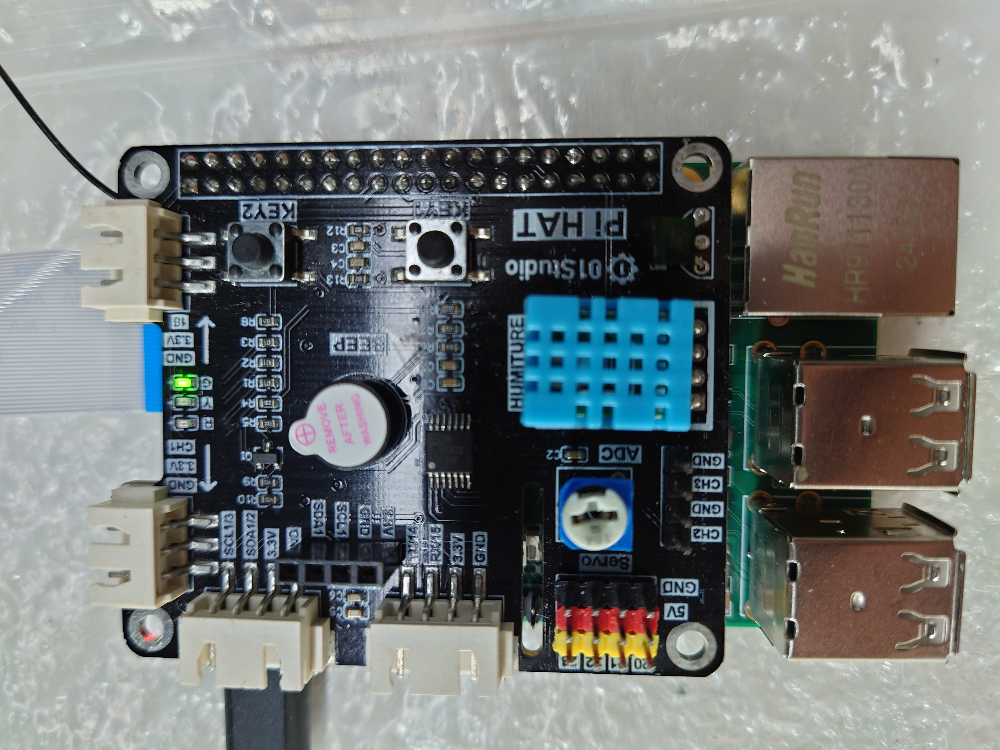
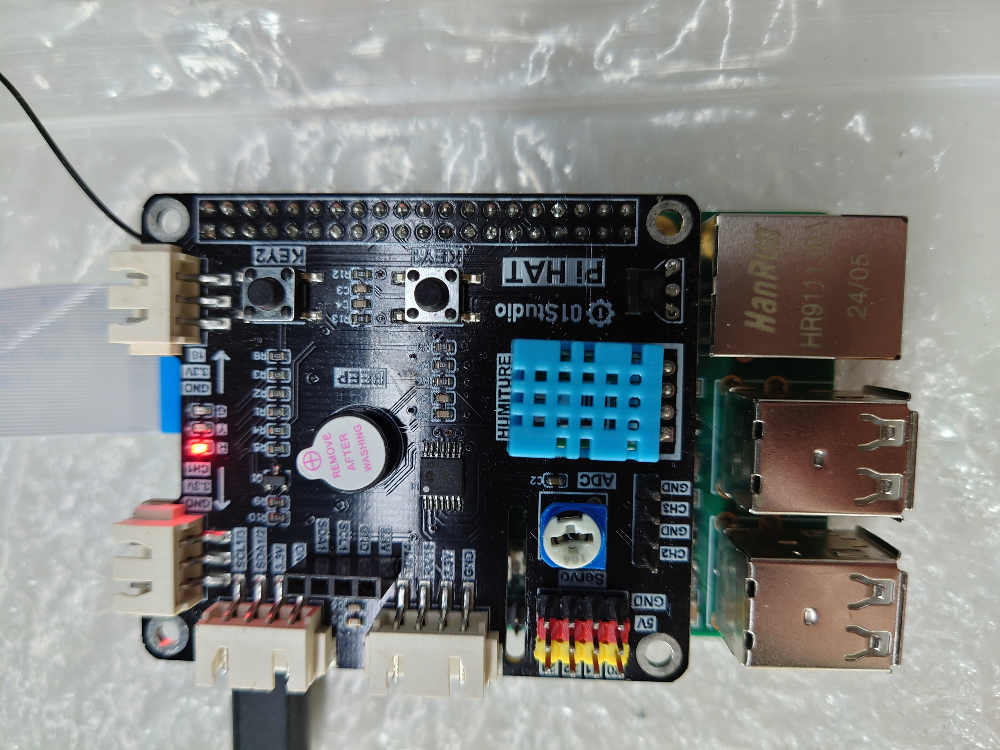
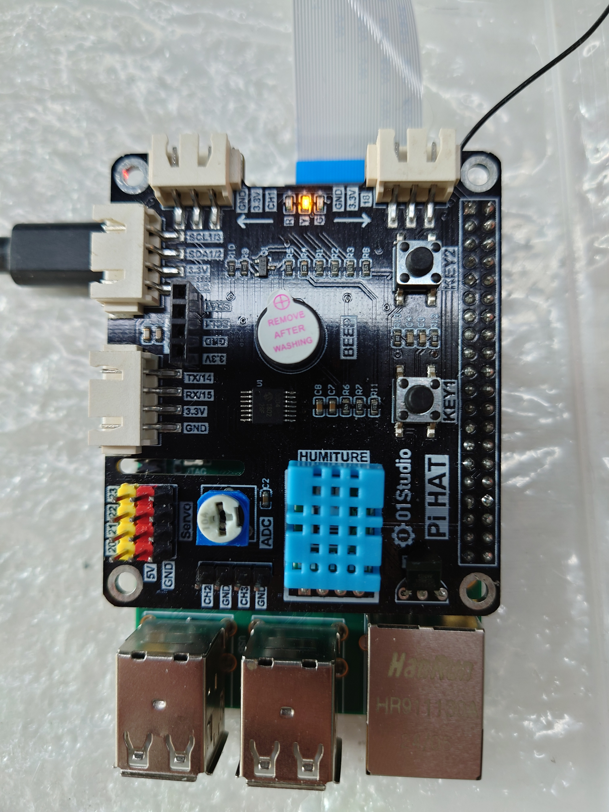
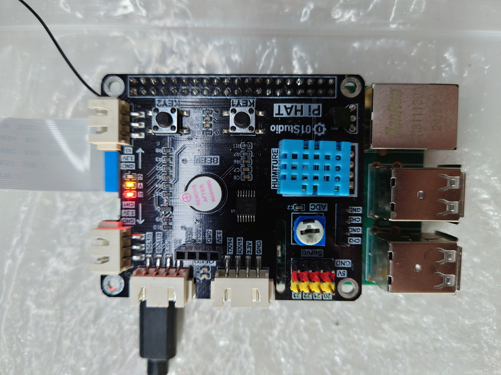

<p align="center">
  <a href="README.md">简体中文</a> |
  <strong>English</strong>
</p>

# Smart Monitoring and Data Acquisition System

## 1. Overview

This project uses the DHT11 sensor on a Pi HAT board to collect ambient temperature and humidity. Thresholds can be configured in the software. When a threshold is exceeded, the buzzer sounds and the corresponding LED indicates the status.

During development, it was necessary to replace the kernel and disable parts of the file system, so the kernel and file system were rebuilt. See the `install` folder under `可执行程序和系统` for details.

Software screenshot:



## 2. Design

The status behavior is:

- When neither value exceeds its threshold, the green LED is on and the buzzer is off.
- When humidity exceeds its threshold, the red LED is on and the buzzer sounds.
- When temperature exceeds its threshold, the yellow LED is on and the buzzer sounds.
- Thresholds can be configured in the software and saved to a file. Collected data is stored in an SQLite database.

Implementation:

1. Qt5 is used for the user interface, while Python 3 controls the peripherals.
2. Python 3 uses an RPi.GPIO library compatible with 2K300 to control the DHT11 sensor, LEDs, and buzzer.
3. SQLite is used to store collected data.

Because the interface uses Qt5, the original OH interface and touch mechanisms are not compatible with Qt display and input handling. The OH system must therefore be rebuilt first.

The Pi HAT configuration must also be selected in the kernel DTS. In this project, the patch for the replaced DTS was appended to `kernel/linux/patches/linux-5.10/ls2k300_vanguard_pi_patch/ls2k300_vanguard_pi_small.patch`, producing a kernel compatible with the Pi HAT.

After rebuilding the system, the compiled Qt5 and Python 3 libraries were added. The Qt5 cross-compilation tools were obtained from the materials provided by the organizer.

### 2.1. Kernel DTS configuration for the Pi HAT

After a build, `ls2k300_pai_pihat.dts` and `ls2k300_pai.dts` can be found under:

`out/ls2k300_vanguard_pi/ls2k300_vanguard_pi_linux/kernel/linux-5.10/arch/loongarch/boot/dts/loongson`

The build uses `ls2k300_pai.dts`. Create a temporary Git repository in `out/ls2k300_vanguard_pi/ls2k300_vanguard_pi_linux/kernel/linux-5.10`, copy `ls2k300_pai_pihat.dts` to `ls2k300_pai.dts`, generate the resulting Git patch, and append it to the patch mentioned above.

### 2.2. Disable the OH display mechanism

Modify `vendor/loongson/ls2k300_vanguard_pi_linux/config.json`:

- Remove the `graphic`, `window`, and `applications` subsystems.
- Set `enable_screensaver` to `false`.
- Remove the `drivers_peripheral_display` component under `hdf`.

### 2.3. Disable the OH touch mechanism

Modify the kernel configuration:

- Disable `CONFIG_DRIVERS_HDF_INPUT`.
- Enable `CONFIG_TOUCHSCREEN_GOODIX`.

Steps:

- In `out/ls2k300_vanguard_pi/ls2k300_vanguard_pi_linux/kernel/linux-5.10`, run `make ls2k300_vanguard_pi_small_defconfig` after running `source set_env.sh`.
- Run `make menuconfig` and apply the configuration above.
- Run `make savedefconfig`.
- Replace `kernel/linux/config/linux-5.10/arch/loongarch/configs/ls2k300_vanguard_pi_small_defconfig` with the generated `defconfig`.

### 2.4. Software implementation

Configure the provided Qt5 cross-compilation tools in Qt Creator, then implement the software. The main functions are:

- Read temperature and humidity from the DHT11 sensor.
- Control the LEDs and buzzer.
- Draw temperature and humidity line charts.
- Write each reading and its timestamp to an SQLite database.

#### 2.4.1. Reading the DHT11

The provided Python 3.9 library contains an RPi.GPIO library that can read the DHT11:

```python
from RPi.GPIO import DHT_sensor

# Sensor types: DHT11, DHT22, and AM2302
sensor = DHT_sensor.DHT11
# The GPIO number connected to the DHT11 on the ls2k300 Pi is 61
pin = 61
while True:
    result, humidity, temperature = DHT_sensor.read_retry(sensor, pin)
    if result == 0:
        print('humidity={0:0.0f} temperature={1:0.0f}'.format(humidity, temperature))
        break
```

The software invokes this script and extracts the temperature and humidity from its output.

#### 2.4.2. Controlling LEDs and the buzzer

The RPi.GPIO library is also used to control the LEDs and buzzer:

```python
from RPi.GPIO import LED
from RPi.GPIO import Buzzer
import time
import sys

def main():
    if len(sys.argv) < 2:
        return

    led_r = LED(88)
    led_y = LED(72)
    led_g = LED(73)
    beep = Buzzer(75, active_high=False)

    if sys.argv[1] == '0':
        led_g.on()
        led_r.off()
        led_y.off()
        beep.off()
    elif sys.argv[1] == '1':
        led_g.off()
        led_r.on()
        led_y.off()
        beep.on()
    elif sys.argv[1] == '2':
        led_g.off()
        led_r.off()
        led_y.on()
        beep.on()
    elif sys.argv[1] == '3':
        led_g.off()
        led_r.on()
        led_y.on()
        beep.on()
    elif sys.argv[1] == '4':
        led_g.off()
        led_r.off()
        led_y.off()
        beep.off()

    time.sleep(0.1)

if __name__ == "__main__":
    main()
```

The script accepts a value from 0 to 4:

- `0`: Neither threshold is exceeded.
- `1`: Humidity exceeds its threshold.
- `2`: Temperature exceeds its threshold.
- `3`: Both thresholds are exceeded.
- `4`: The software is exiting; turn off all LEDs and the buzzer.

#### 2.4.3. Temperature and humidity charts

Use the QChart component.

#### 2.4.4. SQLite database

When the software starts, it checks whether `ss_sample_value.db` exists in the working directory. If not, it creates the database and opens it.

The database contains a table named `ht_data`:

| Field | Description |
| - | - |
| `humidity` | Current humidity reading |
| `temperature` | Current temperature reading |
| `humidity_warning` | Humidity threshold |
| `temperature_warning` | Temperature threshold |
| `status` | Current status (`0`, `1`, `2`, or `3`) |

After each reading, a new row is inserted.

## 3. Deployment

`supervision_system_demo_oh.tar.gz` in the `可执行程序和系统` folder is the deployment package.

First flash a usable system using the flashing package in the `install` folder.

The extracted `supervision_system_demo_oh.tar.gz` contains:

| File | Purpose |
| - | - |
| `python_dht11_read.py` | Reads the DHT11 |
| `python_status_setup.py` | Controls the LEDs and buzzer |
| `run.sh` | Starts the application and declares Qt environment variables |
| `supervision_system_demo` | Main application |

The contents of `run.sh` are:

```shell
#! /bin/sh

export QT_QPA_FB_TSLIB=1
./supervision_system_demo
```

This declares tslib as Qt's input processing library, enabling touch input. Run `run.sh` to start the application.

### 3.1. Application screenshot



### 3.2. Values below thresholds



### 3.3. Humidity above threshold



### 3.4. Temperature above threshold



### 3.5. Both values above thresholds



## 4. License

MIT License

## 5. Demo video

See `智慧监控与数据采集项目演示.mp4`.

## 6. Applications

- Environmental temperature and humidity monitoring and alarms, such as monitoring the inside of a machine and reporting potential risks when thresholds are exceeded.
- Temperature and humidity monitoring in greenhouses. Historical readings can be queried from the database to help investigate problems.
