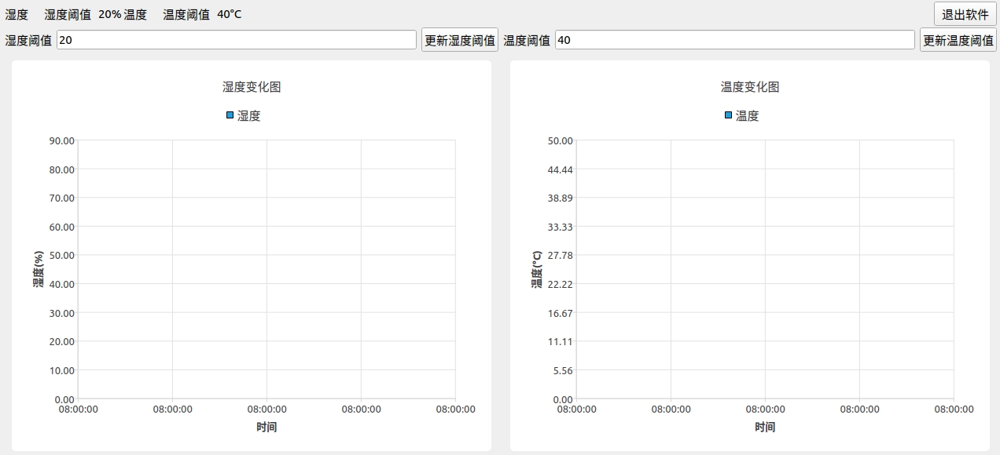
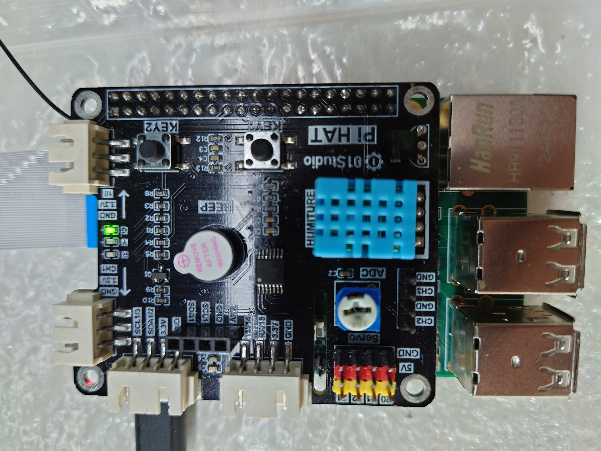
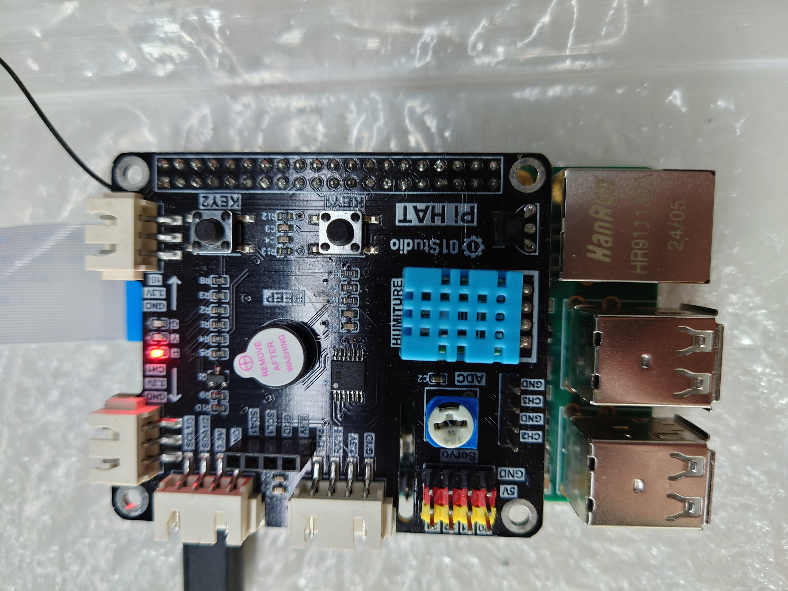
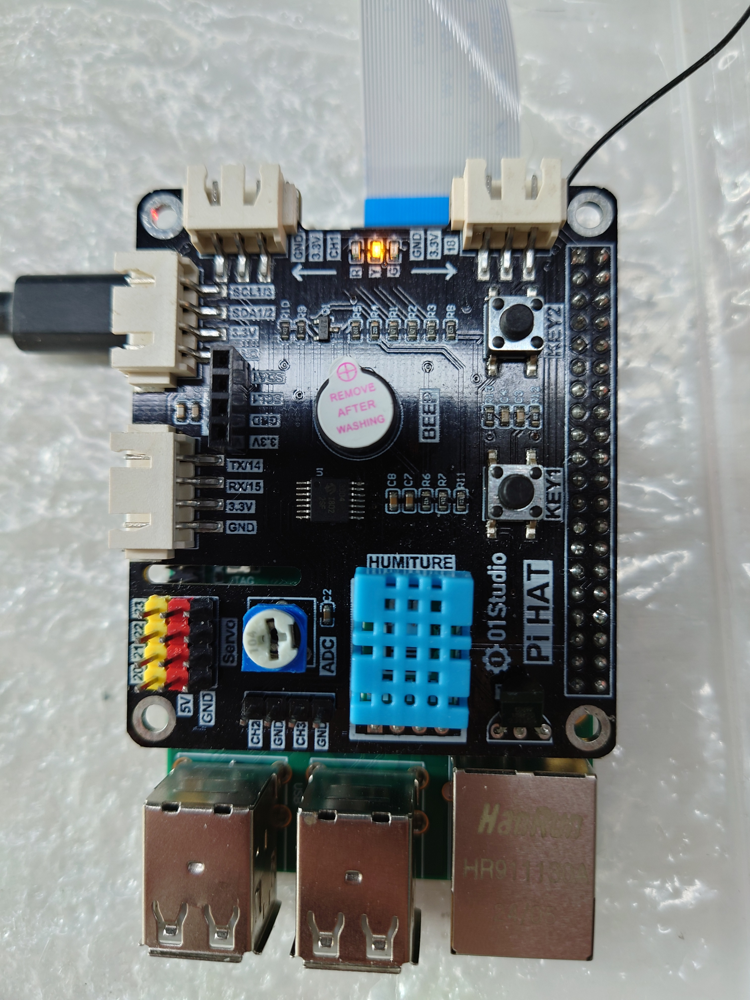
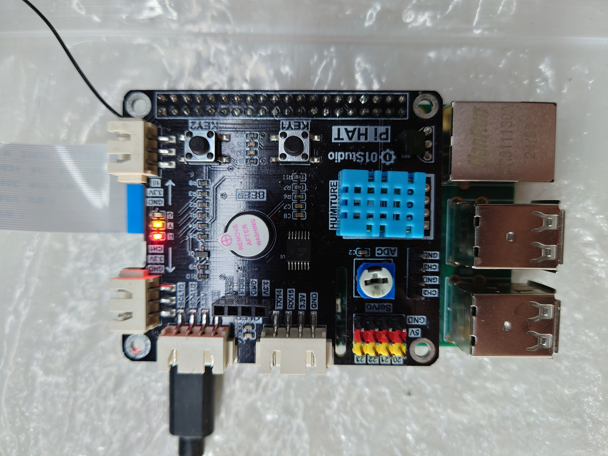

<p align="center">
  <a href="README.zh-CN.md">简体中文</a> |
  <strong>English</strong>
</p>

# Loongson 2K300 Embedded Environmental Monitoring System

**A hardware-software integrated monitoring and data acquisition system built on the Loongson 2K300 platform and OpenHarmony.**

This project demonstrates embedded Linux development, sensor integration, Qt5 graphical interface design, local data persistence, and hardware-level alert control. It was developed as part of a team project for the OpenAtom Open Source Competition and received a **National Second Prize in 2025**.

## 1. Project Overview

The system monitors environmental temperature and humidity using a DHT11 sensor connected through a Pi HAT expansion board. It provides real-time data visualization, configurable warning thresholds, LED and buzzer alerts, and persistent storage of sensor readings.

The project combines platform-level configuration with application development:

- Qt5/C++ manages the user interface, charts, timers, threshold evaluation, and database operations.
- Python scripts launched through Qt `QProcess` read the sensor and control the GPIO devices.
- SQLite3 stores measurements, thresholds, and alert states locally.
- The Linux framebuffer and tslib provide display and touchscreen support on the target device.

### Key Features

- **Environmental monitoring:** Reads temperature and humidity from a DHT11 approximately once per second.
- **Real-time visualization:** Displays current readings and time-series charts using Qt Charts.
- **Configurable alerts:** Allows users to update temperature and humidity warning thresholds.
- **Hardware notifications:** Controls green, red, and yellow LEDs and a buzzer according to the current status.
- **Local data persistence:** Stores valid readings and warning information in an SQLite3 database.
- **Touchscreen interaction:** Uses Qt framebuffer output with tslib-based touchscreen input.
- **Embedded platform adaptation:** Includes OpenHarmony configuration and device-tree changes for Pi HAT compatibility.

## 2. Technology Stack

| Component | Technology |
|---|---|
| Hardware platform | Loongson 2K300 with Pi HAT |
| Operating system | OpenHarmony with Linux kernel 5.10 |
| Main programming languages | C++, C, Python 3 |
| Graphical interface | Qt5, Qt Charts, Qt Virtual Keyboard |
| Sensor | DHT11 |
| Hardware control | RPi.GPIO-compatible library |
| Data storage | SQLite3 |
| Process integration | Qt `QProcess` |
| Timed updates | Qt `QTimer` |
| Display and input | Linux framebuffer, tslib |
| Build system | qmake and GNU make |

## 3. System Architecture

The system consists of four interconnected layers:

**Hardware Layer:** The Loongson 2K300 board interfaces with a DHT11 temperature and humidity sensor, three LEDs, a buzzer, and a touchscreen.

**Platform Layer:** A customized OpenHarmony/Linux environment provides GPIO access, framebuffer output, touchscreen input, and application runtime support.

**Application Layer:** A Qt5/C++ application manages sensor readings, graphical updates, threshold configuration, status evaluation, and database writes.

**Storage Layer:** An SQLite3 database records measurements and their associated warning states.

### Data Flow

```text
             DHT11 Sensor
                  |
                  v
         Python GPIO Script
                  |
                  v
         Qt5 / C++ Application
                  |
         +--------+--------+
         |        |        |
         v        v        v
    Real-time   SQLite3   Threshold
      Charts    Database   Evaluation
                            |
                            v
                       Python GPIO
                            |
                            v
                       LEDs / Buzzer
```

The application launches the Python sensor script with `QProcess`, parses output in the form `humidity=52 temperature=26`, updates the interface, evaluates thresholds, writes valid readings to SQLite, and launches the hardware-control script with the resulting status code.

## 4. Implementation Details

### 4.1 Embedded Platform Configuration

The original embedded display and input mechanisms were not directly compatible with the Qt5 application. The target system therefore required:

- Pi HAT-compatible device-tree configuration.
- Changes to the OpenHarmony display and input configuration.
- `CONFIG_DRIVERS_HDF_INPUT` disabled.
- `CONFIG_TOUCHSCREEN_GOODIX` enabled.
- Qt5 and Python 3 runtime libraries included in the rebuilt system.

The Linux framebuffer is used for graphical output, while `QT_QPA_FB_TSLIB=1` enables tslib-based touchscreen input.

For the detailed kernel, device-tree, and OpenHarmony configuration procedure, see [TUTORIAL.md](TUTORIAL.md).

### 4.2 Sensor Data Acquisition

The DHT11 is read by a Python script using an RPi.GPIO-compatible library. The Qt application:

1. Locates the script in `/opt/supervision_system_demo/` or the current working directory.
2. Starts `python3` through `QProcess`.
3. Waits for the process to finish and reads standard output.
4. Parses the `humidity=... temperature=...` result.
5. Updates the labels and charts when the result is valid.

The acquisition timer runs every 1,000 ms. The chart keeps at most five points to avoid unbounded growth and unnecessary redraw overhead.

### 4.3 Real-Time Visualization

The interface uses Qt Charts with:

- `QLineSeries` for temperature and humidity data.
- `QDateTimeAxis` for the time axis.
- `QValueAxis` for sensor values.
- A five-point sliding window for recent readings.

Temperature and humidity are displayed in separate charts with their own sensor ranges.

### 4.4 Threshold-Based Alert System

Users can update the warning thresholds through the interface. Input validation limits humidity to `0-90%` and temperature to `0-50°C`.

| Status | Condition | LED Indicator | Buzzer |
|---:|---|---|---|
| `0` | Temperature and humidity are within limits | Green | Off |
| `1` | Humidity exceeds its threshold | Red | On |
| `2` | Temperature exceeds its threshold | Yellow | On |
| `3` | Both exceed their thresholds | Red and yellow | On |
| `4` | Application is exiting | All off | Off |

The C++ application sends the status code to the Python hardware-control script, which updates the GPIO devices.

### 4.5 Configuration Persistence

Thresholds are stored in the `humidity_temperature_warning_data` file using this format:

```text
humidity=20 temperature=40
```

The default thresholds are 20% humidity and 40°C temperature. The application uses an exclusive file lock when reading or writing this file. A 200 ms timer checks for updated values so changes made by the interface can be reflected in the running application.

### 4.6 SQLite Data Storage

At startup, the application opens or creates `ss_sample_value.db` and ensures that the `ht_data` table exists:

```sql
CREATE TABLE IF NOT EXISTS ht_data (
    id INTEGER PRIMARY KEY AUTOINCREMENT,
    humidity INTEGER,
    temperature INTEGER,
    humidity_warning INTEGER,
    temperature_warning INTEGER,
    status INTEGER
);
```

Each valid sensor reading is inserted with the thresholds and status used for that reading. The database is local, so the system does not require network connectivity for historical recordkeeping.

## 5. Engineering Challenges

### 5.1 Hardware-Software Compatibility

**Challenge:** The default embedded environment was not directly compatible with the Pi HAT configuration and Qt5 touchscreen application.

**Approach:** Adapt the kernel device tree, modify OpenHarmony display and input settings, and rebuild the target system with the required Qt5 and Python libraries.

### 5.2 Coordination Between Components

**Challenge:** Sensor acquisition, chart updates, database writes, and hardware alerts had to operate together without blocking the user interface.

**Approach:** Keep GPIO operations in Python scripts, coordinate them through `QProcess`, use timer-driven updates, and limit the number of chart points.

### 5.3 Persistent Configuration and Concurrent Access

**Challenge:** Thresholds must survive application restarts while the interface and polling timer may access the same file.

**Approach:** Store thresholds in a local file and protect reads and writes with file locking.

## 6. Repository Structure

```text
chip-monitoring-system/
├── common/
│   ├── sqlite_op/
│   │   ├── sqlite_op.c
│   │   └── sqlite_op.h
│   └── tool/
│       └── tool.h
├── pictures/                       # Screenshots
├── main.cpp                        # Application entry point
├── mainwindow.cpp                  # Sensor and alert logic
├── mainwindow.h                    # Main window declarations
├── mainwindow_init.cpp             # UI, chart, and database initialization
├── mainwindow.ui                   # Qt Designer interface
├── software_env.h                  # Paths, limits, and status constants
├── supervision_system_demo.pro    # Qt/qmake project configuration
├── TUTORIAL.md                     # Detailed implementation tutorial
├── README.md                       # Chinese documentation
├── README.en.md                    # English documentation
└── 可执行程序和系统/
    ├── install/                    # System installation materials
    └── supervision_system_demo_oh.tar.gz
```

The Python deployment scripts and compiled executable are distributed inside `supervision_system_demo_oh.tar.gz`; they are not separate source files in the repository tree.

## 7. Build and Deployment

### 7.1 Build the Qt Application

The project requires a Qt5 development environment with Qt Charts, Qt Virtual Keyboard, SQLite3 development files, qmake, and GNU make.

```bash
qmake supervision_system_demo.pro
make
```

For the target board, use the compatible Qt5 cross-compilation toolchain supplied for the Loongson 2K300 environment.

### 7.2 Deploy to the Target Device

The deployment archive contains:

| File | Purpose |
|---|---|
| `python_dht11_read.py` | Reads the DHT11 |
| `python_status_setup.py` | Controls the LEDs and buzzer |
| `run.sh` | Configures the Qt input environment and starts the application |
| `supervision_system_demo` | Compiled application |

First flash a compatible system image using the materials in the `install` directory. Then extract the deployment archive on the target device and run:

```bash
export QT_QPA_FB_TSLIB=1
./supervision_system_demo
```

The application looks for the Python scripts and data files in `/opt/supervision_system_demo/` first, then in its current working directory.

**Note:** This project targets specialized embedded hardware. It does not run directly on a standard desktop without adapting the GPIO, display, touchscreen, and deployment components.

## 8. Screenshots

### Application Interface



### Normal Monitoring State



### Humidity Warning



### Temperature Warning



### Simultaneous Warning



## 9. Applications

Potential application scenarios include:

- Environmental monitoring inside industrial equipment.
- Temperature and humidity monitoring in agricultural greenhouses.
- Standalone monitoring installations that require local data storage and physical alerts.

## 10. Project Recognition

**OpenAtom Open Source Competition - National Second Prize (2025)**

The project was developed as part of a collaborative embedded systems engineering effort.

## 11. Project Links

- **Repository:** <https://github.com/JAYLI19707/chip-monitoring-system>
- **Technical Documentation:** [TUTORIAL.en.md](TUTORIAL.en.md)
- **Demo video:** The project archive contains the demonstration video referenced by the original documentation.

## 12. License

MIT License

---

*Developed for educational, research, and embedded systems engineering purposes.*
