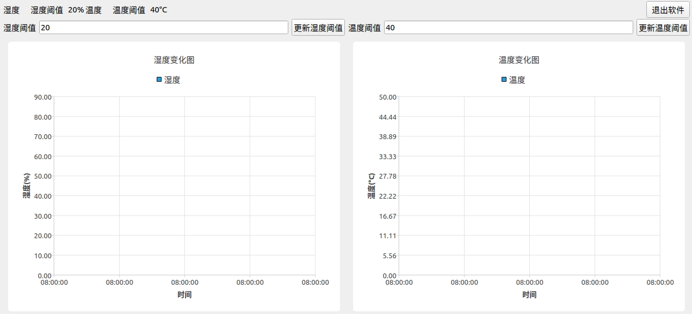
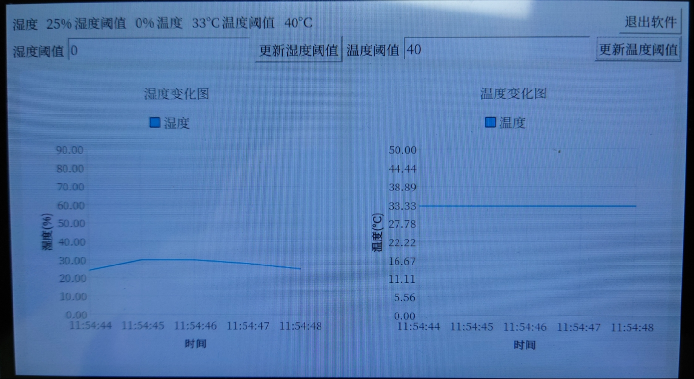
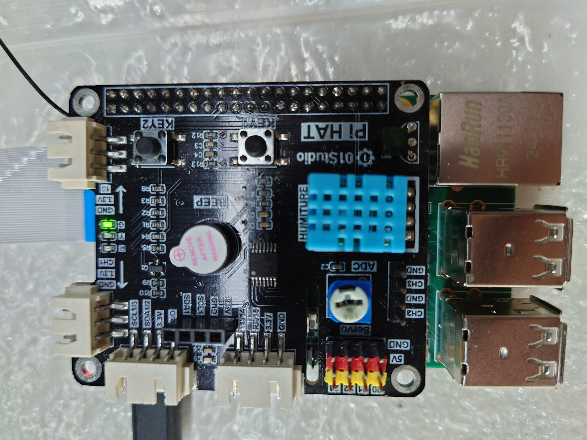
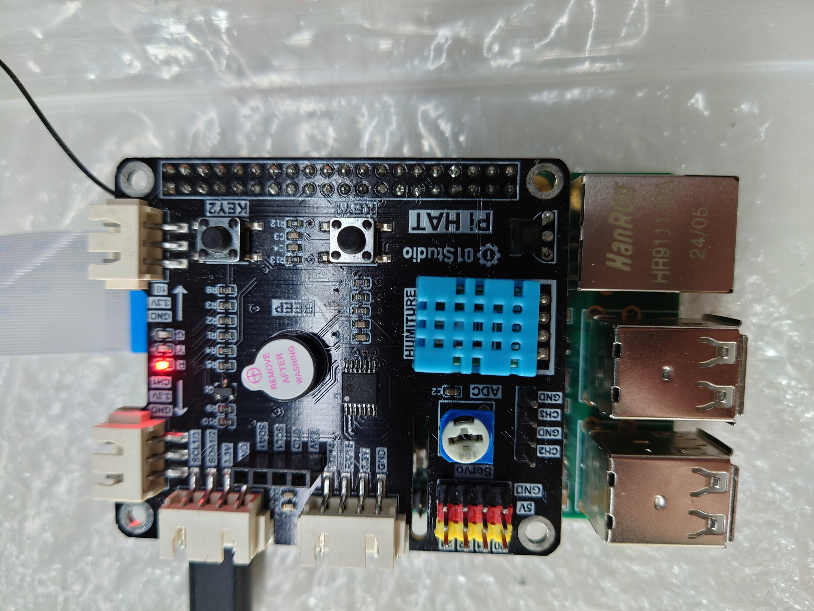
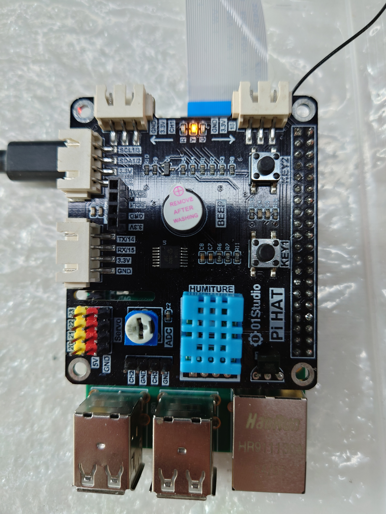
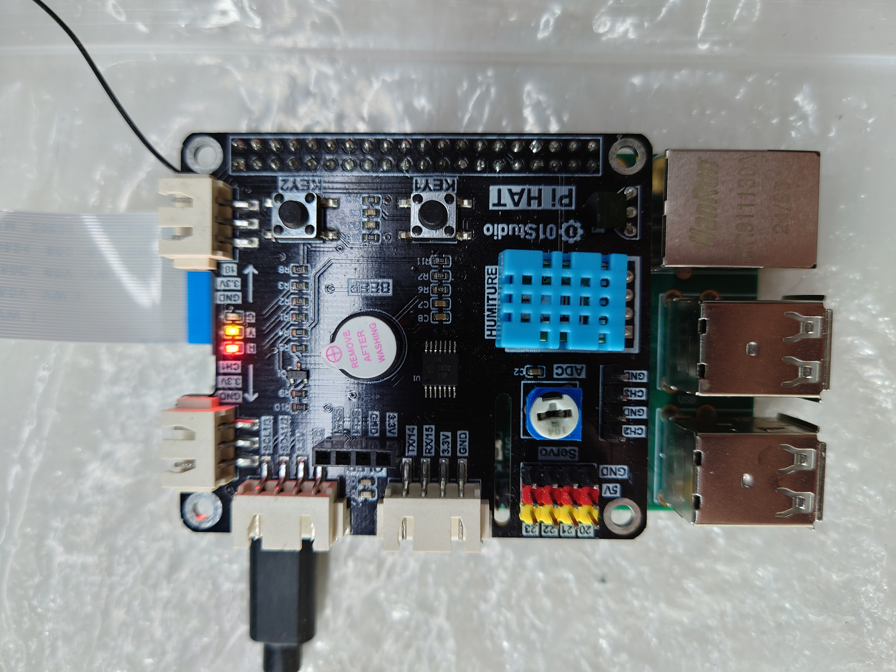

<p align="center">
  <strong>简体中文</strong> |
  <a href="README.md">English</a>
</p>

# 智慧监控与数据采集项目

## 1. 项目概述

本项目使用了Pi HAT板卡上的dht11传感器实现对环境温湿度的采集，软件中可以设置阈值，当超过阈值时，会引发蜂鸣器报警和LED灯对应状态设置。

由于此项目实现过程中发现了需要更换内核和关闭文件系统部分功能才能实现，所以重新编译了内核和文件系统。详见“可执行程序和系统”文件夹中的install文件夹。

软件效果图如下：



## 2. 设计文档

软件效果设计思路如下：

- 当温湿度不超过阈值时，绿色LED灯亮起，蜂鸣器不响；
- 当湿度超过阈值时，红色LED灯亮起，蜂鸣器报警；
- 当温度超过阈值时，黄色LED灯亮起，蜂鸣器报警；
- 阈值可通过软件内设置，并且保存到文件，采集到的数据会存放到sqlite3数据库中。

实现原理：

1. 本实现使用了Qt5实现界面控制和python3控制外设；
2. python3则是使用了兼容2k300的RPi.GPIO库操作DHT11传感器、LED灯、蜂鸣器；
3. 使用了sqlite3数据库实现对采集到的数据保存。

由于使用了Qt5实现界面，原本OH的界面和触控机制没有和Qt的显示与读取输入机制兼容，所以需要先重新编译OH系统。

同时由于使用了Pi HAT板，对应内核的dts应该选用pi_hat的配置，本次的做法是直接将覆盖后的dts的对应patch追加到kernel/linux/patches/linux-5.10/ls2k300_vanguard_pi_patch/ls2k300_vanguard_pi_small.patch，这样编译出来的内核就是使用了兼容Pi HAT的dts的内核。

重新编译系统后，加入Qt5和python3的编译完的库文件。此步骤和Qt5交叉编译工具从主办方提供的资料中获取。

### 2.1. 内核dts配置，兼容Pi HAT板

在一次编译完成后，会在out/ls2k300_vanguard_pi/ls2k300_vanguard_pi_linux/kernel/linux-5.10/arch/loongarch/boot/dts/loongson下见到ls2k300_pai_pihat.dts和ls2k300_pai.dts文件，编译时以ls2k300_pai.dts为准。

所以在out/ls2k300_vanguard_pi/ls2k300_vanguard_pi_linux/kernel/linux-5.10创建一个临时git仓库，把ls2k300_pai_pihat.dts复制为ls2k300_pai.dts文件，之后就会得到git patch，把这个改变追加到前面所述的patch即可。之后重新编译系统时生效。

### 2.2. 取消OH的显示机制

对vendor/loongson/ls2k300_vanguard_pi_linux/config.json修改

- 删除graphic、window、applications子系统；
- enable_screensaver修改为false；
- 删除hdf下的drivers_peripheral_display组件。

### 2.3. 取消OH的触控机制

修改内核配置

- 不选中CONFIG_DRIVERS_HDF_INPUT
- 选中CONFIG_TOUCHSCREEN_GOODIX

具体步骤如下：

- out/ls2k300_vanguard_pi/ls2k300_vanguard_pi_linux/kernel/linux-5.10下执行make ls2k300_vanguard_pi_small_defconfig（注意之前要执行source set_env.sh）；
- make menuconfig，之后按上面配置好，保存；
- make savedefconfig；
- 将生成的defconfig替换成kernel/linux/config/linux-5.10/arch/loongarch/configs/ls2k300_vanguard_pi_small_defconfig

### 2.4. 软件实现

获取提供的Qt5交叉编译工具，配置好QtCreator之后，可以正常开始代码实现。

软件实现功能点如下：

- 实现对DHT11传感器的温湿度采样值获取
- 实现对LED灯和蜂鸣器操作
- 实现软件中温湿度折线图绘制
- 实现将每次读取的温湿度数据连带时间写入sqlite3数据库

#### 2.4.1. DHT11获取

采用提供的python3.9库里面的RPi.GPIO库，可以实现dht11的采样值读取。

参考代码如下：

```python
from RPi.GPIO import DHT_sensor
# 设置传感器类型: 支持 DHT11 , DHT22 和 AM2302
sensor=DHT_sensor.DHT11
# 设置 GPIO 的编号 ls2k300 pai 上链接的 gpio 编号是 61
pin = 61
while True:
    result, humidity, temperature = DHT_sensor.read_retry(sensor, pin)
    if result == 0:
        print('humidity={0:0.0f} temperature={1:0.0f}'.format(humidity, temperature))
        break
```

软件调用此脚本，从脚本打印的文本中提取温湿度。

#### 2.4.2. LED灯和蜂鸣器操作

同样地，采用RPi.GPIO库，可以实现对LED灯的点亮熄灭，蜂鸣器状态设置。

```python
from RPi.GPIO import LED #导入LED模块
from RPi.GPIO import Buzzer #导入 Buzzer 模块
import time
import sys

def main():
    if len(sys.argv) < 2:
        return

    led_r = LED(88) #红灯初始化，连接的是pin 88
    led_y = LED(72) #黄灯初始化，连接的是pin 72
    led_g = LED(73) #绿灯初始化，连接的是pin 73
    beep = Buzzer(75, active_high=False) # 蜂鸣器初始化 链接的是 pin75 低电平时发出响声

    if sys.argv[1] == '0':
        led_g.on()
        led_r.off()
        led_y.off()
        beep.off()
    elif sys.argv[1] == '1':
        led_g.off()
        led_r.on()
        led_y.off()
        beep.on()
    elif sys.argv[1] == '2':
        led_g.off()
        led_r.off()
        led_y.on()
        beep.on()
    elif sys.argv[1] == '3':
        led_g.off()
        led_r.on()
        led_y.on()
        beep.on()
    elif sys.argv[1] == '4':
        led_g.off()
        led_r.off()
        led_y.off()
        beep.off()

    time.sleep(0.1)

if __name__ == "__main__":
    main()
```

脚本接受一个大小为0到4的参数。软件调用时提供不同的参数，就可以将当前温湿度有没有超过阈值的情况报告出来。

- 0 代表温湿度没超过阈值
- 1 代表湿度超过阈值
- 2 代表温度超过阈值
- 3 代表温湿度都超过阈值
- 4 代表软件要退出了，熄灭所有LED，关闭蜂鸣器

#### 2.4.3. 温湿度折线图绘制

使用 QChart 组件实现即可。

#### 2.4.4. sqlite数据库读写实现

软件打开时，检测运行目录下有没有 ss_sample_value.db 文件。如果没有则创建一个同名数据库，之后打开数据库。

数据库有一个名为ht_data的表。

表项分别为 humidity, temperature, humidity_warning, temperature_warning, status

| 表项 | 含义 |
| - | - |
| humidity            | 当前采样湿度 |
| temperature         | 当前采样温度 |
| humidity_warning    | 当前湿度阈值 |
| temperature_warning | 当前温度阈值 |
| status              | 当前状态（对应2.4.2的0 1 2 3状态）|

每次采样之后，就会把新的数据填入表中。

## 3. 部署安装步骤

可执行程序和系统文件夹中supervision_system_demo_oh.tar.gz是可执行程序的部署包。

需要先烧录可用的系统，也就是install文件夹中的烧录套件。

supervision_system_demo_oh.tar.gz 解压后中有以下文件：

| 文件 | 作用 |
| - | - |
| python_dht11_read.py    | 读取dht11的脚本 |
| python_status_setup.py  | 设置LED和蜂鸣器的脚本 |
| run.sh                  | 整体运行时的脚本（要声明QT相关环境变量） |
| supervision_system_demo | 软件程序本体 |

run.sh的内容如下：

```shell
#! /bin/sh

export QT_QPA_FB_TSLIB=1
./supervision_system_demo
```

其实就是先声明了要使用tslib作为Qt的输入处理库，这样才能触屏。

所以直接运行run.sh脚本即可运行程序。

下面是软件运行时的参考图样。

### 3.1. 软件运行时图样



### 3.2. 温湿度不超过阈值时图样



### 3.3. 湿度超过阈值时图样



### 3.4. 温度超过阈值时图样



### 3.5. 温湿度超过阈值时图样



## 4. 开源许可

MIT开源协议

## 5. 演示视频

详见智慧监控与数据采集项目演示.mp4。

## 6. 应用方向

- 环境温湿度检测报警，比如机器内部温湿度检测，当超过阈值时及时报警提示潜在危险。
- 应用于种植棚的温湿度检测。同时可通过查询数据库，追朔温湿度历史数据，方便排查问题。
